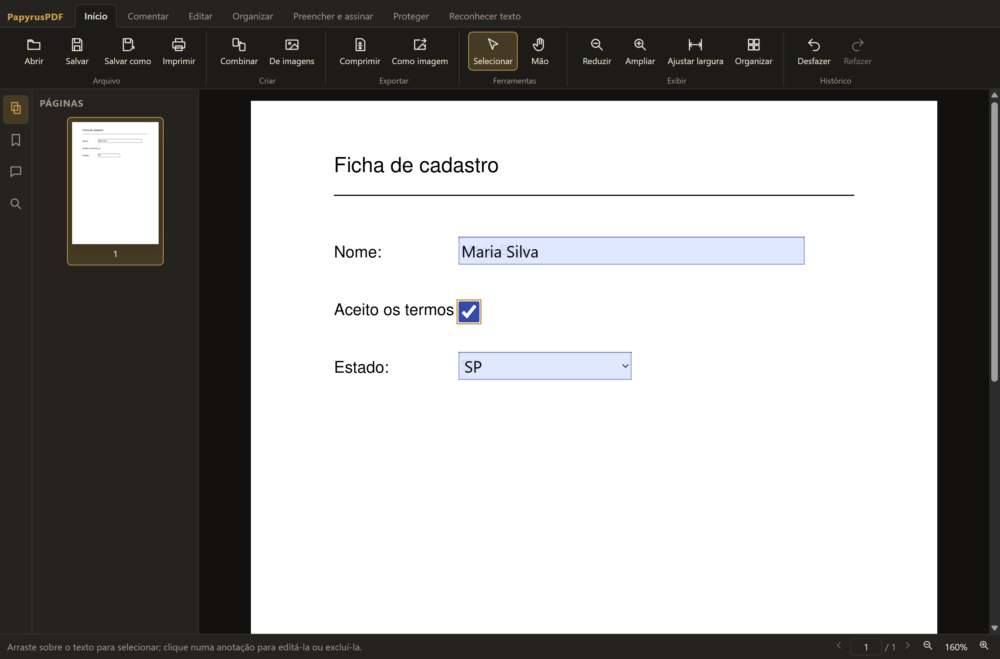
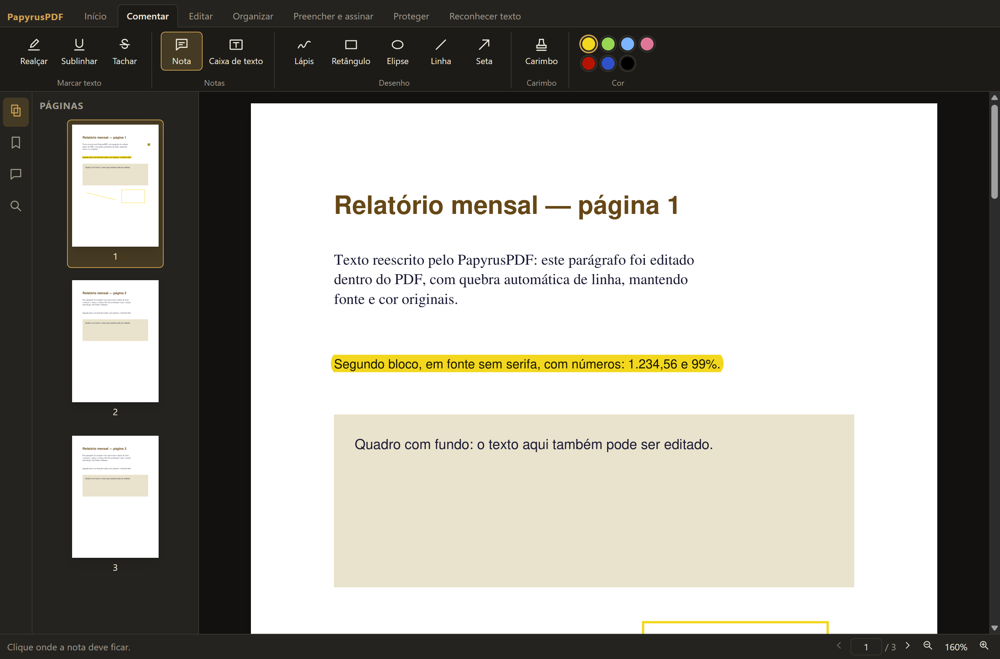

<p align="center">
  
</p>

<h1 align="center">PapyrusPDF</h1>

<p align="center">
  Editor de PDF para Windows, de código aberto, que funciona sem internet.<br>
  Ler, anotar, preencher, assinar, organizar páginas, editar texto, proteger, comprimir e reconhecer texto (OCR).
</p>

<p align="center">
  
  
  
  
  
</p>

<p align="center">
  <a href="https://github.com/lucaszuzu17/PapyrusPDF/releases/latest"><b>⬇ Baixar o instalador para Windows</b></a>
</p>

<p align="center">
  
</p>

> **In English:** PapyrusPDF is an open-source, offline PDF editor for Windows built with Electron, MuPDF and
> Tesseract. It views, prints, annotates, stamps, fills forms, signs, reorders pages, edits existing text,
> password-protects, compresses and OCRs scanned documents. The interface is in Brazilian Portuguese.

## O que ele faz

| Aba | Recursos |
|---|---|
| **Início** | Abrir, salvar, imprimir, combinar PDFs, criar PDF a partir de imagens, comprimir, exportar página como imagem, zoom, desfazer/refazer |
| **Comentar** | Realçar, sublinhar, tachar, nota, caixa de texto, lápis, retângulo, elipse, linha, seta e carimbos (Aprovado, Confidencial, Pago… com data e nome) |
| **Editar** | Editar o texto que já existe no PDF, cabeçalho e rodapé, numeração de páginas, marca d'água |
| **Organizar** | Miniaturas com arrastar e soltar, girar, excluir, página em branco, inserir PDF ou imagem, extrair, dividir |
| **Preencher e assinar** | Campos de formulário (texto, caixa de seleção, lista), assinatura desenhada ou importada, texto livre |
| **Proteger** | Senha para abrir e permissões (AES-256), remover proteção, redação que apaga de verdade o conteúdo por baixo |
| **Reconhecer texto** | OCR em português da página, das páginas escaneadas ou do documento inteiro |

No dia a dia:

- **Arrastar e soltar**: um PDF solto na janela abre; vários são combinados; imagens viram páginas.
- **Recentes**: a tela inicial lista os últimos arquivos, e cada um reabre na página em que ficou.
- **Uma janela só**: abrir outro PDF pelo Explorer reaproveita o programa que já está aberto.
- **Seus arquivos não saem do computador**: não há conta, telemetria nem serviço na nuvem, e o OCR usa um
  modelo de português que vai junto com o programa. A única conexão possível é a do corretor ortográfico
  embutido do Electron, que baixa um dicionário quando o Windows não tem corretor para o idioma do sistema.

Atalhos: `Ctrl+O`, `Ctrl+S`, `Ctrl+Shift+S`, `Ctrl+P`, `Ctrl+Z`, `Ctrl+Y`, `Ctrl+F`, `F3`, `Ctrl` + roda do
mouse, `Esc`, `Delete`.

## Capturas de tela

| Editar o texto do próprio PDF | Carimbo, marca d'água e rodapé |
|---|---|
|  |  |

| Organizar páginas | OCR: o escaneado vira pesquisável |
|---|---|
|  |  |

| Preencher formulários | Anotar e desenhar |
|---|---|
|  |  |

## Instalar

Baixe o `PapyrusPDF-Setup-<versão>.exe` na página de
[Releases](https://github.com/lucaszuzu17/PapyrusPDF/releases/latest) e execute. Cada versão traz o SHA-256 do
arquivo, para quem quiser conferir o download.

- Instalação **por usuário** (não pede administrador), com escolha da pasta, atalhos na Área de Trabalho e no
  Menu Iniciar e desinstalador em "Aplicativos instalados". O instalador fica em português.
- Registra o PapyrusPDF em **"Abrir com"** para arquivos `.pdf`. Ele não vira o leitor padrão sozinho: o Windows
  pede essa escolha ao usuário. Depois de escolhido, os PDFs ganham o ícone abaixo.
- **Não é assinado digitalmente.** Na primeira execução o SmartScreen avisa "O Windows protegeu o computador":
  clique em *Mais informações* → *Executar assim mesmo*.
- Instalar uma versão nova por cima atualiza e mantém a assinatura salva e as preferências.
- Para gerar o instalador a partir do código, siga a seção [Desenvolver](#desenvolver) e rode `npm run dist`; o
  arquivo sai em `dist\PapyrusPDF-Setup-<versão>.exe`.

<p>
  
  &nbsp;&nbsp;
  
</p>

## Desenvolver

Requisitos: Windows 10 ou 11 (64 bits) e Node.js 24.2 ou mais novo.

```bash
npm install
```

```bash
npm start
```

`npm start` compila e abre o aplicativo. Para abrir um arquivo direto:
`npx electron-vite preview -- caminho\do\arquivo.pdf`.

| Comando | O que faz |
|---|---|
| `npm run dev` | Abre com recarga automática da interface |
| `npm test` | 18 testes do motor (abrir, editar, anotar, OCR, senha, compressão, marcas, imagens, regressões) |
| `npm run e2e` | 4 cenários no aplicativo real, com mouse e teclado de verdade; capturas em `test/e2e-out/` |
| `npm run e2e:dist` | Os mesmos cenários no aplicativo empacotado (`dist\win-unpacked`) |
| `npm run typecheck` | Verificação de tipos |
| `npm run icon` | Redesenha os ícones (`build/icon.ico` e `build/file.ico`) |
| `npm run fixtures` | Recria os PDFs de exemplo em `test/fixtures/` (o `e2e` faz isso sozinho se faltarem) |

Para rodar só um cenário: `node test/run-e2e.mjs --only=recursos` (os outros são `amostra`, `formulario` e
`escaneado`). Os testes de ponta a ponta precisam da janela em primeiro plano, porque usam o teclado de verdade.

O `npm install` termina baixando o executável do Electron (cerca de 160 MB, uma única vez). Se esse download
falhar por causa de rede ou proxy, `npm start` para com o erro `Electron uninstall`; rode `npx install-electron`
para tentar de novo.

## Como funciona

```
src/engine/   núcleo sem interface (MuPDF + tesseract.js), testável direto no Node
  core.ts       PdfEngine: abrir, renderizar, texto, busca, anotações, campos, páginas, editar texto, OCR
  ocr-node.ts   OCR offline com o modelo de português empacotado (@tesseract.js-data/por)
  types.ts      tipos compartilhados com a interface
src/main/     processo principal do Electron
  index.ts      janela, diálogos de arquivo, IPC, impressão, recentes, instância única
  engine-worker.ts  thread do motor (o MuPDF não trava a janela)
src/preload/  ponte segura (contextIsolation) entre interface e processo principal
src/renderer/src/  interface React (o index.html fica em src/renderer/)
  Ribbon.tsx    faixa de opções declarativa (abas → grupos → comandos)
  Viewer.tsx / PageView.tsx  leitor contínuo + camada de interação por página
  features.ts   comandos com formulário (proteger, comprimir, cabeçalho, marca d'água, carimbo, exportar)
  images.ts     preparo de imagens (EXIF, conversão) e desenho dos carimbos
  Sidebar.tsx, Organizer.tsx, Dialogs.tsx, state.tsx
build/        ícones, desenhados em vetor pelo próprio MuPDF (make-icon.ts)
test/         testes do motor e roteiro de ponta a ponta
```

**Edição de texto.** O texto da área é removido com uma redação restrita a texto (imagens e desenhos ficam) e
o novo texto é escrito no conteúdo da página numa fonte padrão do PDF parecida com a original (Helvetica, Times
ou Courier, com negrito e itálico), na mesma cor, tamanho e linha de base, com quebra automática de linha.

**OCR.** A página é renderizada a 300 dpi, o Tesseract reconhece as palavras e o PapyrusPDF escreve uma camada
de texto invisível sob a imagem, ajustada à largura de cada palavra. O PDF passa a ser pesquisável e
selecionável sem mudar a aparência.

**Imprimir** abre o diálogo de impressão do Windows. As páginas vão como imagem (200 dpi; 150 dpi acima de 80
páginas; pranchas maiores que A3 ficam limitadas a cerca de 3500 px no lado maior), ajustadas à área
imprimível; páginas deitadas são giradas para aproveitar a folha.

**Proteger com senha** grava um arquivo novo (ou por cima do atual) e passa a trabalhar nele. Sem senha de
abertura valem só as restrições (imprimir, copiar, alterar, comentar), que outros programas respeitam mas não
são uma barreira de segurança. Quem protege de verdade é a senha de abertura.

**Comprimir** grava uma cópia: imagens grandes são reduzidas e regravadas em JPEG (leve ≤ 2600 px, média
≤ 1800 px, forte ≤ 1200 px no lado maior). Texto e desenhos vetoriais não perdem qualidade.

**Cabeçalho, rodapé e numeração** aceitam os marcadores `{p}` (número da página), `{n}` (último número),
`{total}` (total de páginas), `{data}` e `{arquivo}`. Cada aplicação é um único "desfazer".

**Imagens → PDF** aceita PNG, JPEG, BMP, GIF e WebP; fotos de celular com rotação EXIF entram em pé.

O aplicativo é empacotado sem `asar` de propósito: o MuPDF e o OCR rodam em threads que carregam o WASM e o
modelo de português direto do `node_modules`.

## Limitações conhecidas

- **Fonte na edição de texto:** o texto editado usa uma das 14 fontes padrão do PDF, não a fonte original
  embutida. Em documentos com fontes muito características a diferença aparece. Caracteres fora do
  Windows-1252 (emoji, grego, cirílico) viram "?" no texto editado e no OCR.
- **Desfazer** vale até o último "Salvar" (o histórico do MuPDF não sobrevive ao salvamento). Proteger,
  remover proteção e comprimir também reiniciam o histórico.
- **Impressão por imagem:** o texto sai nítido a 200 dpi, mas não é vetorial; para gráfica, envie o PDF.
- **Compressão** não mexe em máscaras de 1 bit, imagens com máscara por cor-chave nem imagens pequenas;
  imagens em tinta especial (Pantone) são convertidas para RGB.
- Ainda não há assinatura digital com certificado (a assinatura é visual) nem atualização automática.
- O OCR reconhece **português**; outros idiomas exigem adicionar o pacote `@tesseract.js-data/<idioma>` e
  ajustar `src/engine/ocr-node.ts`, onde o idioma e o caminho do modelo estão fixos em português.
- Só há versão para Windows.

> O programa se chamava "Papiro PDF" até a versão 0.2. Alguns nomes internos (`window.papiro`,
> `papiro.signature`, o nome do pacote `papiro-pdf`) continuam com o nome antigo de propósito, para que as
> preferências de quem já usava continuem valendo.

## Licença e créditos

PapyrusPDF é software livre sob a **GNU Affero General Public License v3.0 ou posterior**
([LICENSE](LICENSE)). Você pode usar, estudar, modificar e redistribuir, desde que as versões redistribuídas
continuem abertas sob a mesma licença.

Ele só existe graças a estes projetos:

| Projeto | Papel | Licença |
|---|---|---|
| [MuPDF](https://mupdf.com/) (`mupdf` para JavaScript, da Artifex) | Ler, renderizar e gravar PDF | AGPL-3.0-or-later |
| [tesseract.js](https://github.com/naptha/tesseract.js) e o modelo de português do Tesseract | OCR | Apache-2.0 (o pacote npm do modelo, `@tesseract.js-data/por`, declara MIT) |
| [Electron](https://www.electronjs.org/) | Janela e empacotamento | MIT |
| [React](https://react.dev/) | Interface | MIT |
| [electron-vite](https://electron-vite.org/) e [electron-builder](https://www.electron.build/) | Compilação e instalador | MIT |

A escolha da AGPL vem do MuPDF: quem quiser distribuir uma versão fechada precisa de uma licença comercial da
Artifex.
