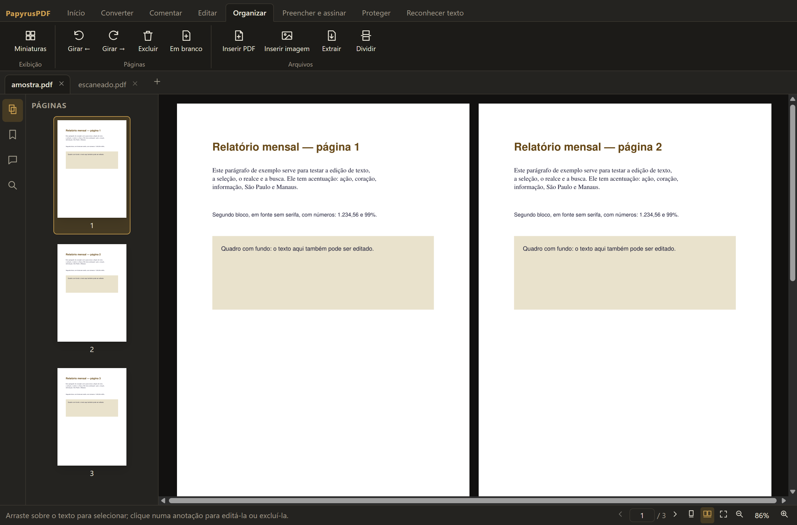
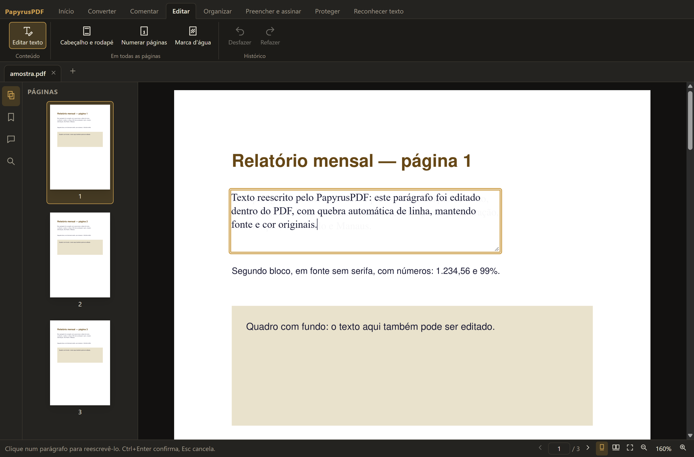
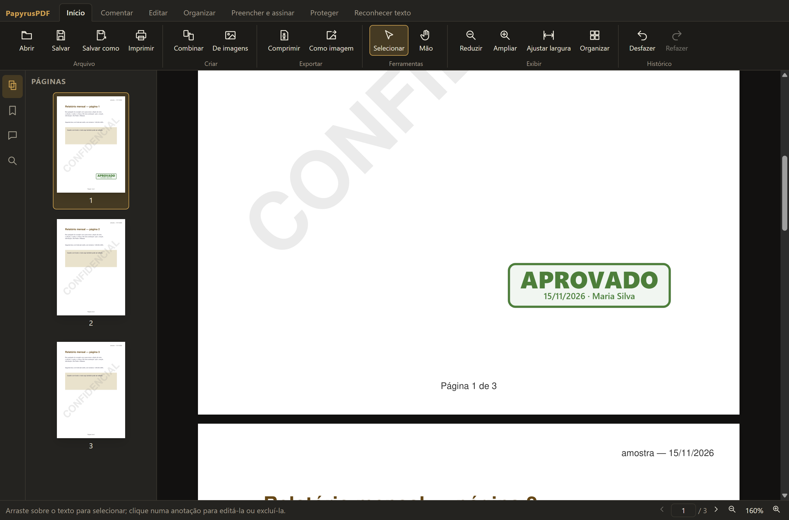
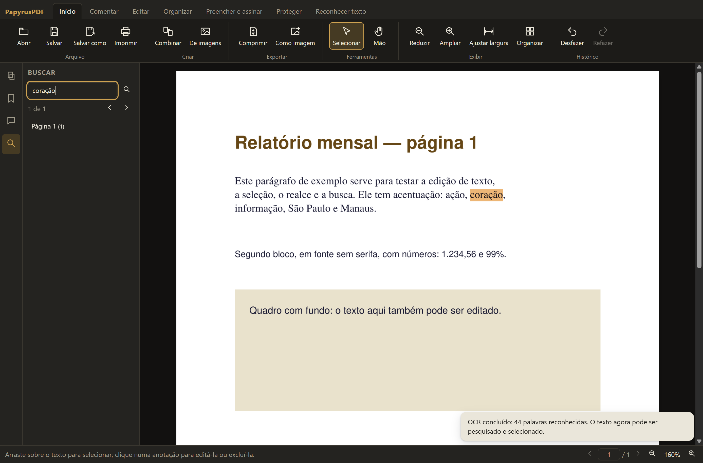
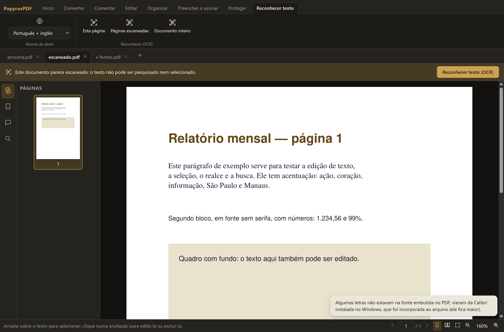
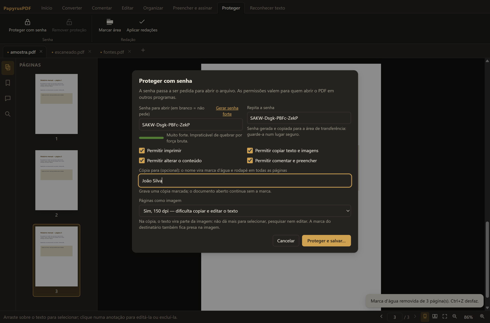

<p align="center">
  
</p>

<h1 align="center">PapyrusPDF</h1>

<p align="center">
  Editor de PDF para Windows, de código aberto, que funciona sem internet.<br>
  Ler em abas, anotar, preencher, assinar, organizar páginas, editar texto na fonte original, converter para Word,<br>
  proteger, comprimir e reconhecer texto (OCR) em português, inglês e espanhol.
</p>

<p align="center">
  
  
  
  
  
</p>

<p align="center">
  <a href="https://github.com/lucaszuzu17/PapyrusPDF/releases/latest"><b>⬇ Baixar o instalador para Windows</b></a> ·
  <a href="CHANGELOG.md"><b>Histórico de mudanças (Changelog)</b></a>
</p>

<p align="center">
  
</p>

> **In English:** PapyrusPDF is an open-source, offline PDF editor for Windows built with Electron, MuPDF and
> Tesseract. It opens documents in tabs, views, prints, annotates, stamps, fills forms, signs, reorders pages,
> edits existing text keeping the document's own embedded font, converts to Word (.docx) and plain text,
> password-protects, compresses and OCRs scanned documents (Portuguese, English, Spanish). The interface is in
> Brazilian Portuguese.

## O que ele faz

| Aba | Recursos |
|---|---|
| **Início** | Abrir, salvar, imprimir, combinar PDFs, criar PDF a partir de imagens, comprimir, zoom, duas páginas lado a lado, tela cheia, desfazer/refazer |
| **Converter** | Do PDF para Word (.docx), texto (.txt) ou imagem (PNG/JPEG); de imagens para PDF; combinar |
| **Comentar** | Realçar, sublinhar, tachar, nota, caixa de texto, lápis, retângulo, elipse, linha, seta e carimbos (Aprovado, Confidencial, Pago… com data e nome) |
| **Editar** | Editar o texto que já existe no PDF, na fonte embutida no próprio documento; cabeçalho e rodapé, numeração de páginas, marca d'água e **remover marca d'água** (do Word, Acrobat, Foxit e PapyrusPDF) |
| **Organizar** | Miniaturas com arrastar e soltar, girar, excluir, página em branco, inserir PDF ou imagem, extrair, dividir |
| **Preencher e assinar** | Campos de formulário (texto, caixa de seleção, lista), assinatura desenhada ou importada, texto livre |
| **Proteger** | Senha para abrir e permissões (AES-256) com medidor de força e gerador de senha forte, cópia marcada com o nome do destinatário, cópia com as páginas em imagem, remover proteção, redação que apaga de verdade o conteúdo por baixo |
| **Reconhecer texto** | OCR da página, das páginas escaneadas ou do documento inteiro, em português, inglês, espanhol ou combinados |

No dia a dia:

- **Abas**: cada PDF abre na sua aba, como num navegador, e cada uma lembra a página, o zoom e a busca.
  Abrir de novo um arquivo que já está aberto só traz a aba dele para a frente.
- **Arrastar e soltar**: um PDF solto na janela abre numa aba nova; vários são combinados; imagens viram páginas.
- **Recentes**: a tela inicial lista os últimos arquivos, e cada um reabre na página em que ficou.
- **Uma janela só**: abrir outro PDF pelo Explorer acrescenta uma aba no programa que já está aberto.
- **Seus arquivos não saem do computador**: não há conta, telemetria nem serviço na nuvem. O OCR usa modelos
  de idioma que vão junto com o programa, e o corretor ortográfico do Electron fica desligado (ele baixaria um
  dicionário da internet). O PapyrusPDF não faz nenhuma conexão.

Atalhos: `Ctrl+O`, `Ctrl+S`, `Ctrl+Shift+S`, `Ctrl+P`, `Ctrl+W` (fecha a aba), `Ctrl+Tab` / `Ctrl+Shift+Tab`
(troca de aba), `Ctrl+Z`, `Ctrl+Y`, `Ctrl+F`, `F3`, `F11` (tela cheia; setas trocam de página), `Ctrl` + roda
do mouse, `Esc`, `Delete`.

## Capturas de tela

| Abas e duas páginas lado a lado | Texto editado na fonte do próprio documento |
|---|---|
|  |  |

| Editar o texto do próprio PDF | Carimbo, marca d'água e rodapé |
|---|---|
|  |  |

| Organizar páginas | OCR: o escaneado vira pesquisável |
|---|---|
|  |  |

| Idioma do OCR | Senha forte e cópia para destinatário |
|---|---|
|  |  |

| Preencher formulários | Anotar e desenhar |
|---|---|
|  |  |

## Instalar

Baixe o `PapyrusPDF-Setup-<versão>.exe` na página de
[Releases](https://github.com/lucaszuzu17/PapyrusPDF/releases/latest) e execute. Cada versão traz o SHA-256 do
arquivo, para quem quiser conferir o download.

- Instalação **por usuário** (não pede administrador), com escolha da pasta, atalhos na Área de Trabalho e no
  Menu Iniciar e desinstalador em "Aplicativos instalados". O instalador fica em português.
- Registra o PapyrusPDF em **"Abrir com"** para arquivos `.pdf`. Ele não vira o leitor padrão sozinho: o Windows
  pede essa escolha ao usuário. Depois de escolhido, os PDFs ganham o ícone abaixo.
- **Não é assinado digitalmente.** Na primeira execução o SmartScreen avisa "O Windows protegeu o computador":
  clique em *Mais informações* → *Executar assim mesmo*.
- Instalar uma versão nova por cima atualiza e mantém a assinatura salva e as preferências.
- Para gerar o instalador a partir do código, siga a seção [Desenvolver](#desenvolver) e rode `npm run dist`; o
  arquivo sai em `dist\PapyrusPDF-Setup-<versão>.exe`.

<p>
  
  &nbsp;&nbsp;
  
</p>

## Desenvolver

Requisitos: Windows 10 ou 11 (64 bits) e Node.js 24.2 ou mais novo.

```bash
npm install
```

```bash
npm start
```

`npm start` compila e abre o aplicativo. Para abrir um arquivo direto:
`npx electron-vite preview -- caminho\do\arquivo.pdf`.

| Comando | O que faz |
|---|---|
| `npm run dev` | Abre com recarga automática da interface |
| `npm test` | 55 testes do motor (abrir, editar, fonte original, Type 3, anotar, OCR em três idiomas, senha, compressão, marcas d'água, cópia por destinatário, imagens, Word, CSV, comparar, texto, regressões) |
| `npm run e2e` | 5 cenários no aplicativo real, com mouse e teclado de verdade; capturas em `test/e2e-out/` |
| `npm run e2e:dist` | Os mesmos cenários no aplicativo empacotado (`dist\win-unpacked`) |
| `npm run typecheck` | Verificação de tipos |
| `npm run icon` | Redesenha os ícones (`build/icon.ico` e `build/file.ico`) |
| `npm run fixtures` | Recria os PDFs de exemplo em `test/fixtures/` (o `e2e` faz isso sozinho se faltarem) |

Para rodar só um cenário: `node test/run-e2e.mjs --only=recursos` (os outros são `amostra`, `formulario`,
`escaneado` e `abas`). Os testes de ponta a ponta precisam da janela em primeiro plano, porque usam o teclado de verdade.

O `npm install` termina baixando o executável do Electron (cerca de 160 MB, uma única vez). Se esse download
falhar por causa de rede ou proxy, `npm start` para com o erro `Electron uninstall`; rode `npx install-electron`
para tentar de novo.

## Como funciona

```
src/engine/   núcleo sem interface (MuPDF + tesseract.js), testável direto no Node
  core.ts       PdfEngine: abrir, renderizar, texto, busca, anotações, campos, páginas, editar texto, OCR, converter
  fonts.ts      reaproveita a fonte embutida no PDF na edição de texto (lê o ToUnicode e as larguras)
  fontname.ts   nome PostScript da fonte → família e estilo ("TimesNewRomanPS-BoldMT" → Times New Roman, negrito)
  type3.ts      repara /FontBBox invertido e recupera texto/negrito de fontes vetoriais Type 3 sem /ToUnicode
  docx.ts       monta o .docx (WordprocessingML + ZIP) a partir do texto e das imagens das páginas
  tables.ts     extrai tabelas e dados tabulares para CSV
  compare.ts    compara dois PDFs (diferenças de texto e mapa visual)
  watermarks.ts acha e remove marcas d'água (conteúdo marcado, camadas, XObjects e a do Word no cabeçalho)
  ocr-node.ts   OCR offline com os modelos empacotados (@tesseract.js-data/por, eng e spa)
  types.ts      tipos compartilhados com a interface
src/main/     processo principal do Electron
  index.ts      janela, diálogos de arquivo, IPC, impressão, recentes, instância única, tela cheia
  engine-worker.ts  thread do motor (o MuPDF não trava a janela), com um documento por aba
  system-fonts.ts   acha no Windows a fonte equivalente à do PDF (pelo registro de fontes)
src/preload/  ponte segura (contextIsolation) entre interface e processo principal
src/renderer/src/  interface React (o index.html fica em src/renderer/)
  Ribbon.tsx    faixa de opções declarativa (abas → grupos → comandos)
  Viewer.tsx / PageView.tsx  leitor contínuo (uma ou duas páginas) + camada de interação por página
  features.ts   comandos com formulário (proteger, comprimir, cabeçalho, marca d'água, carimbo, exportar, converter)
  password.ts   medidor de força e gerador de senhas
  images.ts     preparo de imagens (EXIF, conversão) e desenho dos carimbos
  state.tsx     estado do aplicativo e das abas
  Sidebar.tsx, Organizer.tsx, Dialogs.tsx
build/        ícones, desenhados em vetor pelo próprio MuPDF (make-icon.ts)
test/         testes do motor e roteiro de ponta a ponta
```

**Edição de texto.** O texto da área é removido com uma redação restrita a texto (imagens e desenhos ficam) e
o novo texto é escrito no conteúdo da página, na mesma cor, tamanho e linha de base, com quebra automática de
linha. Cada letra sai, nesta ordem:

1. na **fonte embutida no próprio PDF**, quando ela tem a letra. O PapyrusPDF lê o mapa de caracteres
   (ToUnicode) e as larguras da fonte e reaproveita o mesmo objeto, então o trecho fica igual ao resto;
2. na **mesma fonte instalada no Windows**, quando a embutida é um subconjunto sem aquela letra (o Word, por
   exemplo, só embute as letras que o documento usa). A fonte do Windows é incorporada ao PDF, que fica maior,
   e o programa avisa quando isso acontece;
3. numa **fonte padrão do PDF** parecida (Helvetica, Times ou Courier), se nenhuma das duas tiver a letra.

**Abas.** Cada aba tem o seu documento no motor; a interface guarda a página, o zoom, a busca e a seleção de
cada uma enquanto outra está na frente. Fechar a aba libera a memória do documento.

**Converter para Word** gera um `.docx` com o texto de cada página em parágrafos (fonte, tamanho, cor,
negrito, itálico e alinhamento), as imagens no lugar em que aparecem e uma seção por página, com o tamanho e a
orientação dela. O resultado é para editar no Word, não uma cópia fiel do layout.

**Remover marca d'água** procura, em todas as páginas, o que os programas identificam como marca d'água: o
conteúdo marcado como marca d'água (Acrobat, Foxit e o próprio PapyrusPDF), camadas e formulários de marca
d'água, anotações do tipo marca d'água e a marca d'água do Word. O Word grava a marca como parte do cabeçalho; o
PapyrusPDF mede cada trecho do cabeçalho e tira o que fica no meio da página e é grande. Logotipos no topo e
papel timbrado de página inteira ficam. Tudo pode ser desfeito com `Ctrl+Z`.

**Senhas e cópias.** O medidor estima a força pela variedade de caracteres e pelo tamanho, e desconta datas,
sequências e senhas muito usadas. O gerador cria senhas de 16 caracteres aleatórios em 4 grupos (cerca de 90
bits) e as copia para a área de transferência. A **cópia para destinatário** escreve o nome na diagonal de todas
as páginas e num rodapé com a data; com **páginas como imagem**, cada página vira um JPEG do mesmo tamanho, e o
nome fica preso na imagem. Nos dois casos o documento aberto não muda.

**OCR.** A página é renderizada a 300 dpi, o Tesseract reconhece as palavras no idioma escolhido e o PapyrusPDF
escreve uma camada de texto invisível sob a imagem, ajustada à largura de cada palavra. O PDF passa a ser
pesquisável e selecionável sem mudar a aparência. Os modelos de português, inglês e espanhol vão no instalador.

**Imprimir** abre o diálogo de impressão do Windows. As páginas vão como imagem (200 dpi; 150 dpi acima de 80
páginas; pranchas maiores que A3 ficam limitadas a cerca de 3500 px no lado maior), ajustadas à área
imprimível; páginas deitadas são giradas para aproveitar a folha.

**Proteger com senha** grava um arquivo novo (ou por cima do atual) e passa a trabalhar nele. Sem senha de
abertura valem só as restrições (imprimir, copiar, alterar, comentar), que outros programas respeitam mas não
são uma barreira de segurança. Quem protege de verdade é a senha de abertura.

**Comprimir** grava uma cópia: imagens grandes são reduzidas e regravadas em JPEG (leve ≤ 2600 px, média
≤ 1800 px, forte ≤ 1200 px no lado maior). Texto e desenhos vetoriais não perdem qualidade.

**Cabeçalho, rodapé e numeração** aceitam os marcadores `{p}` (número da página), `{n}` (último número),
`{total}` (total de páginas), `{data}` e `{arquivo}`. Cada aplicação é um único "desfazer".

**Imagens → PDF** aceita PNG, JPEG, BMP, GIF e WebP; fotos de celular com rotação EXIF entram em pé.

O aplicativo é empacotado sem `asar` de propósito: o MuPDF e o OCR rodam em threads que carregam o WASM e os
modelos de idioma direto do `node_modules`.

## Limitações conhecidas

- **Fonte na edição de texto:** o parágrafo editado inteiro sai na fonte da primeira linha (negrito ou itálico
  só numa parte do trecho se perde). Fontes Type3 e CID com outras codificações não são reaproveitadas: o texto
  sai na fonte do Windows de mesmo nome ou numa fonte padrão. Letras que nem a fonte do documento nem a do
  Windows têm (emoji, por exemplo) viram "?". No OCR, caracteres fora do Windows-1252 também viram "?".
- **Remover marca d'água** não tira carimbos e imagens comuns colados na página, nem marcas d'água feitas
  por programas que não as identificam como tal; carimbos que são anotações saem com *Selecionar* e
  `Delete`. Numa página escaneada, a marca faz parte da imagem e só dá para cobri-la com a redação.
- **Senha:** nenhum PDF se protege sozinho contra tentativas de senha. Quem tem o arquivo pode testar senhas
  à vontade no próprio computador, e quem tem a senha pode salvar uma cópia sem ela. O que protege é uma senha
  longa e aleatória; a marca do destinatário serve para saber de onde veio uma cópia vazada.
- **Converter para Word** leva texto e imagens, não desenhos vetoriais, tabelas nem colunas; páginas
  escaneadas viram imagens (rode o OCR antes para ter texto editável).
- **Desfazer** vale até o último "Salvar" (o histórico do MuPDF não sobrevive ao salvamento). Proteger,
  remover proteção e comprimir também reiniciam o histórico.
- **Impressão por imagem:** o texto sai nítido a 200 dpi, mas não é vetorial; para gráfica, envie o PDF.
- **Compressão** não mexe em máscaras de 1 bit, imagens com máscara por cor-chave nem imagens pequenas;
  imagens em tinta especial (Pantone) são convertidas para RGB.
- Ainda não há assinatura digital com certificado (a assinatura é visual) nem atualização automática.
- O OCR reconhece **português, inglês e espanhol**; outros idiomas exigem adicionar o pacote
  `@tesseract.js-data/<idioma>` e incluí-lo em `src/engine/ocr-node.ts` e na lista `OCR_LANGS` da interface.
- Só há versão para Windows.

> O programa se chamava "Papiro PDF" até a versão 0.2. Alguns nomes internos (`window.papiro`,
> `papiro.signature`, o nome do pacote `papiro-pdf`) continuam com o nome antigo de propósito, para que as
> preferências de quem já usava continuem valendo.

## Licença e créditos

PapyrusPDF é software livre sob a **GNU Affero General Public License v3.0 ou posterior**
([LICENSE](LICENSE)). Você pode usar, estudar, modificar e redistribuir, desde que as versões redistribuídas
continuem abertas sob a mesma licença.

Ele só existe graças a estes projetos:

| Projeto | Papel | Licença |
|---|---|---|
| [MuPDF](https://mupdf.com/) (`mupdf` para JavaScript, da Artifex) | Ler, renderizar e gravar PDF | AGPL-3.0-or-later |
| [tesseract.js](https://github.com/naptha/tesseract.js) e os modelos de português, inglês e espanhol do Tesseract | OCR | Apache-2.0 (os pacotes npm dos modelos, `@tesseract.js-data/*`, declaram MIT) |
| [Electron](https://www.electronjs.org/) | Janela e empacotamento | MIT |
| [React](https://react.dev/) | Interface | MIT |
| [electron-vite](https://electron-vite.org/) e [electron-builder](https://www.electron.build/) | Compilação e instalador | MIT |

A escolha da AGPL vem do MuPDF: quem quiser distribuir uma versão fechada precisa de uma licença comercial da
Artifex.
