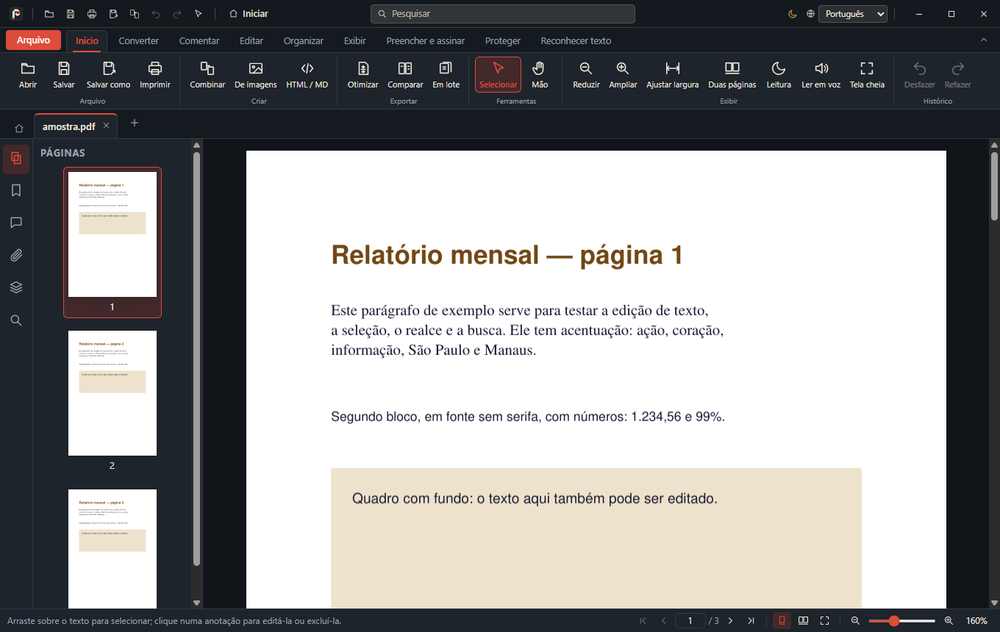
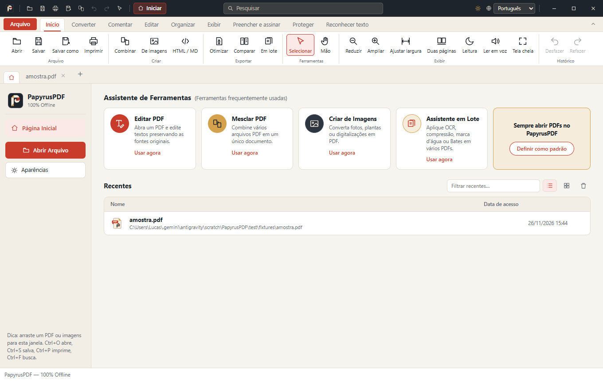
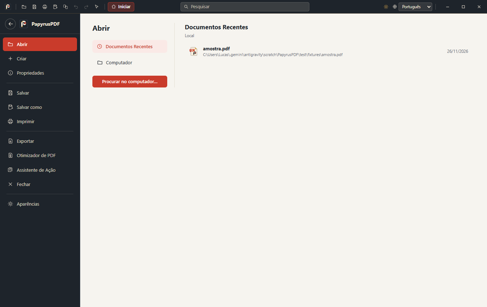
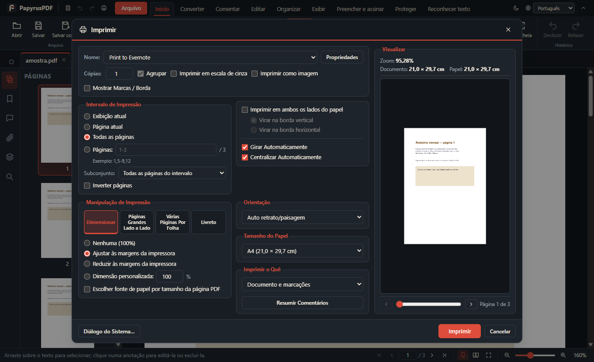
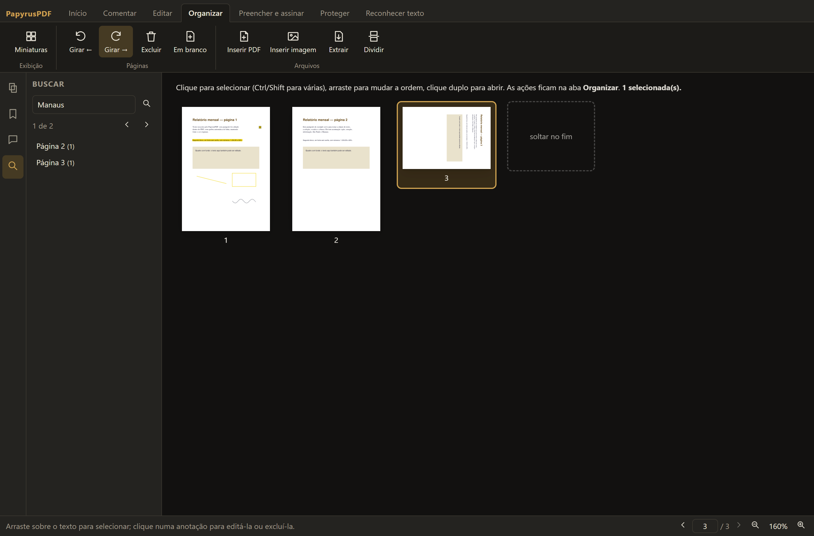
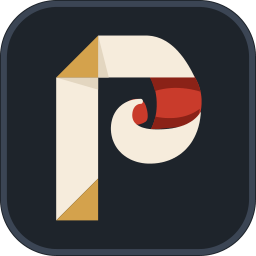
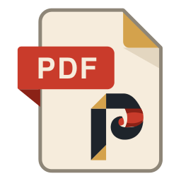

<p align="center">
  
</p>

<h1 align="center">PapyrusPDF</h1>

<p align="center">
  <strong>Open-source, 100% offline PDF editor for Windows.</strong><br>
  <em>Editor de PDF gratuito, de código aberto e 100% offline para Windows.</em>
</p>

<p align="center">
  
  
  
  
  
  
  
</p>

<p align="center">
  <a href="https://github.com/lucaszuzu17/PapyrusPDF/releases/latest"><b>⬇ Download Windows Installer</b></a> ·
  <a href="CHANGELOG.md"><b>Changelog</b></a> ·
  <a href="#english"><b>🇺🇸 English</b></a> ·
  <a href="#portugues"><b>🇧🇷 Português</b></a>
</p>

<p align="center">
  
</p>

---

<a id="english"></a>

## 🇺🇸 English

**PapyrusPDF** is a fast, native-feeling Windows PDF editor built with **Electron 45**, **MuPDF**, **ONNX Runtime (PaddleOCR PP-OCRv5)**, and **Tesseract**, designed to work **100% offline** — no accounts, no cloud uploads, no telemetry, and zero network calls.

### Highlights

- **Modern Foxit-Inspired Workspace:** Custom integrated top title bar (Quick Access Toolbar, global PDF search bar, 1-click Day/Night theme switcher, language selector, and custom window controls), tabbed Ribbon, full-screen **File** Backstage, and **Start / Home** screen with Quick Tools and searchable Recent Documents.
- **Signature Visual Identity:** Crafted around the **Monogram P** palette (charcoal `#1E242B`, parchment cream `#F6ECDC`, antique gold `#D4A24C`, and crimson `#C93B2B`) with Light Parchment, Dark Charcoal, and System Auto themes.
- **Direct PDF Text Editing (Vector & Scanned):** Rewrite existing paragraphs preserving embedded fonts (with automatic Windows font fallback and Type 3 recovery) — and edit or erase text even on **scanned / rasterized PDFs after OCR** with automatic background color sampling and cover patches.
- **Offline Neural OCR (PP-OCRv4/v5 ONNX):** Bundled 19.4 MB Apache-2.0 neural models with automatic `0° / 90° / 180° / 270°` orientation detection, local shadow removal, adaptive contrast, and `±6°` deskew across 32 Latin languages (plus Tesseract Best/Fast fallback).
- **Advanced Print Dialog with Live Preview (`Ctrl+P`):** Scale (`100%`, Fit, Shrink, Custom %, choose paper by PDF size), Poster Tiling (overlap & cut marks), N-Up (`2 / 4 / 6 / 9 / 16`), Booklet imposition, Duplex, Grayscale, Print as Image (300 DPI), custom page ranges, odd/even subsets, reverse order, and live MuPDF preview.
- **Privacy, Forms & Digital Signatures:** AES-256 encryption, offline PKCS#12 / ICP-Brasil A1 digital signing & verification, interactive AcroForm builder with auto-field detection, smart PII/LGPD redaction, metadata sanitization, PDF space audit & optimization, visual + text PDF comparison, and multi-step batch workflows.

### Feature Overview

| Section / Tab | Capabilities |
|---|---|
| **Top Title Bar** | Brand icon, Quick Access Toolbar (**Open, Save, Print, Save As, Merge, Undo, Redo, Select/Hand**), **Start** toggle, integrated **Search** bar (`Enter` / `Shift+Enter`, match counter `1/N`), **1-click Day/Night** theme toggle, **UI Language** (`EN / PT / ES / System`), and custom window controls |
| **File (Backstage)** | Recent Documents, Create PDF, Document Properties, Save / Save As, **Advanced Print Dialog**, Export, PDF Optimizer, Action Wizard, Close, and **Appearance & Language** (System / Light Parchment / Dark Charcoal) |
| **Home** | Open, Save, Save As, Print, Combine PDFs, Create from Images, **HTML / Markdown → PDF (100% offline)**, Space Audit & Optimizer, Compare PDFs, Batch Wizard, Select / Hand, Zoom, Two-Page Spread, Reading Mode (Normal / Sepia / Night), Offline Read Aloud (TTS), Full Screen, Undo / Redo across saves |
| **Convert** | PDF → Word (`.docx`), Tables → CSV (Excel), Plain Text (`.txt`), Images (`PNG / JPG`); Images, HTML/Markdown, and Combine → PDF |
| **Comment** | Highlight, Underline, Strikeout, Sticky Notes, Text Boxes, Pencil, Rectangle, Ellipse, Line, Arrow, Stamps (date + author), **Measurement Ruler** (`1:1` to `1:500`), **Comments Summary Export** (PDF / Markdown / CSV) & sidebar filter |
| **Edit** | **Edit Text** (embedded fonts + floating formatting toolbar + resizable box + scanned/OCR background cover), Add Unicode Text, Add Image, Clickable Links, Find & Replace, Header & Footer, Page Numbers, **Bates Numbering**, Watermark & **Remove Watermark** (Word, Acrobat, Foxit, PapyrusPDF) |
| **Organize** | Drag-and-drop Thumbnail Grid, Rotate, Delete, Insert Blank Page, Crop Margins (mm), Standardize to A4 / Letter, **Page Labels (`/PageLabels`)**, Insert PDF or Images, Extract Pages, Split Document |
| **View** | Single Page, Two-Page Spread, Full Screen, Zoom Controls & Status Slider, Reading Mode (Normal / Sepia / Night), Offline Read Aloud (TTS), Compare PDFs |
| **Fill & Sign** | Fill interactive forms, Visual Signature (draw/import), Type on PDF, **Interactive Form Builder** (text, multiline, checkbox, dropdown, signature), **Auto-Detect Fields**, **Offline A1 / `.pfx` / `.p12` Digital Signatures** & Verification |
| **Protect** | AES-256 Password & Permissions (strength meter + generator), Recipient-Watermarked Copies, Image-Only Rasterized Copies, Remove Security, **Flatten PDF**, **Sanitize Hidden Metadata (Info / XMP)**, Manual Redaction & **Smart PII / LGPD Redaction** |
| **Recognize Text** | **Neural PP-OCRv5 (ONNX)** + Tesseract Best/Fast, Auto-Orientation (`0°/90°/180°/270°`), Local Shadow Removal, Adaptive Contrast & `±6°` Deskew |

### Screenshots

| Dark Mode (Charcoal `#1E242B`) | Start / Home Screen & Quick Tools |
|---|---|
|  |  |

| File Backstage Menu | Advanced Print Dialog with Live Preview |
|---|---|
|  |  |

| Direct Text Editing (Original Font) | Page Organizer & Offline OCR |
|---|---|
|  |  |

### Installation (Windows)

Download `PapyrusPDF-Setup-1.0.2.exe` from the [Latest Release](https://github.com/lucaszuzu17/PapyrusPDF/releases/latest) and run it.

- **Per-user installation** (no administrator privileges required), multi-language NSIS installer (`English`, `Português`, `Español`), Desktop & Start Menu shortcuts, and clean uninstaller.
- Registers PapyrusPDF in Windows **"Open with"** for `.pdf` files with custom icons without hijacking your default viewer (you can set it as default anytime from the Start screen).
- **Unsigned open-source binary:** On first run, Windows SmartScreen may show *"Windows protected your PC"* — click **More info → Run anyway**.

<p>
  
  &nbsp;&nbsp;&nbsp;
  
</p>

### Keyboard Shortcuts

`Ctrl+O` Open · `Ctrl+S` Save · `Ctrl+Shift+S` Save As · `Ctrl+P` Print · `Ctrl+W` Close Tab · `Ctrl+Tab` / `Ctrl+Shift+Tab` Switch Tabs · `Ctrl+Z` / `Ctrl+Y` Undo / Redo · `Ctrl+F` / `Ctrl+H` Find / Replace · `F3` Next Match · `F11` Full Screen · `Ctrl + Wheel` Zoom · `Ctrl+0` Fit Width · `Esc` Select Tool · `Delete` Delete Selected Annotation.

### Development

**Requirements:** Windows 10 or 11 (64-bit) and **Node.js 24.2+**.

```bash
npm install
npm start
```

| Command | Description |
|---|---|
| `npm run dev` | Start Electron + Vite with hot reload |
| `npm run typecheck` | TypeScript strict type check (`tsc --noEmit`) |
| `npm test` | Run all **80 automated unit & integration tests** (engine, fonts, Type 3, scanned OCR editing, annotations, Print helpers, Neural PP-OCRv5 + cleanup, Tesseract, A1 signatures, form builder, Tier 1/2 features, i18n) |
| `npm run build` | Build Electron `main`, `preload`, and `renderer` bundles |
| `npm run dist` | Package Windows x64 NSIS installer (`dist\PapyrusPDF-Setup-<version>.exe`) |
| `npm run e2e` | Run end-to-end UI scenarios with real mouse/keyboard input |
| `npm run e2e:dist` | Run E2E scenarios against `dist\win-unpacked` |
| `npm run icon` | Regenerate pure-vector icons (`build/icon.ico`, `build/file.ico`, `build/icon.png`) |

### Architecture

```text
build/make-icon.ts      MuPDF pure-vector icon generator (Monogram P + PDF side-tag file icon)
models/ocr/             Bundled Apache-2.0 PaddleOCR ONNX models (19.4 MB, 100% offline)
  det.onnx                PP-OCRv4 mobile DBNet++ text detector
  rec_latin.onnx          PP-OCRv5 Latin SVTR recognizer (32 languages)
  dict_latin.txt          Latin character dictionary
  doc_ori.onnx            PP-LCNet 0°/90°/180°/270° document orientation classifier
src/shared/
  i18n.ts                 Typed offline translations (en, pt, es) + OS locale resolver
  print-types.ts          Print job options, range parser, scale/poster/N-up/booklet math
src/engine/             UI-free PDF engine (MuPDF + ONNX Runtime + Tesseract + node-forge)
  core.ts                 PdfEngine: render, text editing, scanned cover patch, annotations, OCR, print, undo-across-saves
  ocr-paddle.ts           PaddleOCR PP-OCRv4/v5 ONNX inference + word-level CTC boxes
  ocr-prep.ts             Local shadow removal, adaptive contrast, 90°/180°/270° rotation, ±6° deskew
  ocr-node.ts             Unified OCR router (Neural PP-OCRv5 default + Tesseract Best/Fast)
  sign.ts                 Offline PKCS#7/CMS digital signatures (.pfx/.p12) & verification
  forms.ts                Interactive AcroForm builder & automatic field detector
  tier1.ts                Smart PII/LGPD redaction, comments summary export, auto-bookmarks
  fonts.ts / fontname.ts  Embedded PDF font reuse, ToUnicode parsing, Windows font fallback
  type3.ts                Type 3 vector font /FontBBox repair & glyph-OCR recovery
  docx.ts / tables.ts     Word (.docx) & CSV table exporters
  compare.ts              Side-by-side text + visual pixel-diff PDF comparison
  watermarks.ts           Watermark detection & removal (Acrobat, Foxit, Word, PapyrusPDF)
src/main/               Electron main process
  index.ts                Frameless hidden-titlebar window, IPC, Print engine, HTML/MD→PDF, auto-recovery, recents
  engine-worker.ts        Dedicated worker thread (one PdfEngine instance per open tab)
  markdown.ts             Offline Markdown-to-HTML renderer
  system-fonts.ts         Windows system font lookup
src/preload/            contextIsolation bridge (window.papiro)
src/renderer/src/       React 19 UI (TitleBar, Ribbon, FileBackstage, PrintDialog, Viewer, PageView, Sidebar, Organizer, Dialogs, BrandMark, TTS, state)
test/                   80 automated Node tests + live Electron E2E suite
```

### Known Limitations

- **Single font style per edited paragraph:** Rewriting a paragraph applies its predominant font style across that block.
- **Word export:** Focuses on editable paragraphs, formatting, and images rather than a fixed-layout clone; run OCR first on scanned PDFs.
- **Offline signature verification:** Validates SHA-256 `ByteRange` integrity, PKCS#7 cryptography, and certificate dates locally without online OCSP/CRL checks (to preserve 100% offline privacy).
- **Platform:** Built and packaged for Windows 10/11 (x64).

### License & Credits

Licensed under **GNU Affero General Public License v3.0 or later** ([LICENSE](LICENSE)).

| Project | Role | License |
|---|---|---|
| [MuPDF](https://mupdf.com/) (`mupdf` JS by Artifex) | PDF parsing, rendering, editing & writing | AGPL-3.0-or-later |
| [PaddleOCR](https://github.com/PaddlePaddle/PaddleOCR) (PP-OCRv4/v5 & PP-LCNet) | Neural OCR detection, recognition & orientation | Apache-2.0 |
| [ONNX Runtime](https://onnxruntime.ai/) (`onnxruntime-node`) | Offline CPU neural inference | MIT |
| [tesseract.js](https://github.com/naptha/tesseract.js) & `@tesseract.js-data/*` | Secondary / fallback OCR engine | Apache-2.0 / MIT |
| [node-forge](https://github.com/digitalbazaar/forge) | Offline PKCS#12 / PKCS#7 digital signatures | BSD-3-Clause / GPL-2.0 |
| [Electron](https://www.electronjs.org/) & [React](https://react.dev/) | Desktop runtime & UI | MIT |
| [electron-vite](https://electron-vite.org/) & [electron-builder](https://www.electron.build/) | Bundling & Windows NSIS installer | MIT |

---

<a id="portugues"></a>

## 🇧🇷 Português

O **PapyrusPDF** é um editor de PDF rápido, gratuito e de código aberto para Windows, feito com **Electron 45**, **MuPDF**, **ONNX Runtime (PaddleOCR PP-OCRv5)** e **Tesseract**. Funciona **100% offline** — sem conta, sem envio de documentos para a nuvem, sem telemetria e sem nenhuma requisição de rede.

### Principais Destaques

- **Interface Moderna estilo Foxit:** Barra superior integrada (Acesso Rápido, pesquisa global no PDF, alternador Dia/Noite em 1 clique, seletor de idioma e controles próprios da janela), faixa de opções (Ribbon) em abas, menu **Arquivo (Backstage)** em tela cheia e **Tela Inicial** com Assistente de Ferramentas e Documentos Recentes filtráveis.
- **Identidade Visual Própria:** Paleta baseada no ícone oficial **Monograma P Dobrado** (carvão `#1E242B`, pergaminho `#F6ECDC`, dourado `#D4A24C` e carmesim `#C93B2B`), com temas **Claro (Pergaminho)**, **Escuro (Carvão)** e **Automático (Sistema)**.
- **Edição Direta de Texto (Vetorial e Escaneado):** Reescreva parágrafos preservando a fonte embutida original (com fallback para fontes do Windows e reparo de fontes Type 3) — e edite ou apague texto inclusive em **PDFs escaneados / rasterizados após OCR**, com detecção automática da cor de fundo local para cobrir os pixels originais.
- **OCR Neural Offline (PP-OCRv4/v5 ONNX):** Modelos Apache-2.0 embarcados (19,4 MB) com auto-orientação `0° / 90° / 180° / 270°`, remoção local de sombras, contraste adaptativo e endireitamento `±6°` em português, inglês, espanhol e mais 29 idiomas latinos (com fallback para Tesseract Alta Precisão / Rápido).
- **Diálogo de Impressão Avançado com Prévia ao Vivo (`Ctrl+P`):** Dimensionar (`100%`, Ajustar, Reduzir, Personalizado %, escolher papel pelo tamanho do PDF), Páginas Grandes Lado a Lado / Pôster (sobreposição e marcas de corte), Várias Páginas por Folha (`2 / 4 / 6 / 9 / 16`), Livreto, Frente e Verso (Duplex), Escala de Cinza, Imprimir como Imagem (300 DPI), intervalos personalizados, páginas ímpares/pares, ordem inversa e prévia em tempo real.
- **Privacidade, Formulários e Assinatura Digital:** Senha AES-256 com medidor de força e gerador, assinatura digital offline com certificado **A1 (`.pfx` / `.p12`, ICP-Brasil)** e verificação de integridade, criador de formulários interativos com detecção automática de campos, **Redação Inteligente LGPD**, limpeza de metadados ocultos, otimizador com auditoria de espaço, comparação de PDFs (texto + visual) e processamento em lote.

### Recursos por Seção / Aba

| Seção / Aba | Recursos |
|---|---|
| **Barra Superior** | Ícone do app, Acesso Rápido (**Abrir, Salvar, Imprimir, Salvar como, Combinar, Desfazer, Refazer, Selecionar/Mão**), botão **Iniciar**, campo **Pesquisar** integrado (`Enter` / `Shift+Enter`, contador `1/N`), alternador **Dia/Noite em 1 clique**, seletor de **Idioma** (`PT / EN / ES / Sistema`) e controles da janela |
| **Arquivo (Backstage)** | Documentos Recentes, Criar PDF, Propriedades do Documento, Salvar / Salvar como, **Diálogo de Impressão Avançado**, Exportar, Otimizador de PDF, Assistente de Ação, Fechar e **Aparências e Idioma** |
| **Início** | Abrir, Salvar, Salvar como, Imprimir, Combinar PDFs, Criar de Imagens, **HTML / Markdown → PDF (100% offline)**, Otimizar, Comparar PDFs, Em lote, Selecionar / Mão, Zoom, Duas páginas, Modo de Leitura (Normal / Sépia / Noturno), Leitura em Voz Alta offline (TTS), Tela cheia, Desfazer / Refazer mesmo após salvar |
| **Converter** | PDF → Word (`.docx`), Tabelas → Planilha CSV (Excel), Texto puro (`.txt`), Imagens (`PNG / JPG`); Imagens, HTML/Markdown e Combinar → PDF |
| **Comentar** | Realçar, Sublinhar, Tachar, Nota adesiva, Caixa de texto, Lápis, Retângulo, Elipse, Linha, Seta, Carimbos (com data e nome), **Régua de Medição** (`1:1` até `1:500`), **Resumo de Comentários** (PDF / Markdown / CSV) e filtros laterais |
| **Editar** | **Editar texto** (fonte original + barra flutuante de formatação + caixa redimensionável + cobertura automática em PDFs escaneados), Inserir texto Unicode, Inserir imagem, Links clicáveis, Localizar e Substituir, Cabeçalho e Rodapé, Numerar páginas, **Numeração Bates**, Marca d'água e **Remover marca d'água** (Word, Acrobat, Foxit e PapyrusPDF) |
| **Organizar** | Grade de miniaturas arrastável, Girar, Excluir, Inserir página em branco, Recortar margens (mm), Padronizar para A4 / Carta, **Rótulos de Página (`/PageLabels`)**, Inserir PDF ou Imagens, Extrair páginas, Dividir documento |
| **Exibir** | Uma página, Duas páginas lado a lado, Tela cheia, Zoom + controle deslizante na barra inferior, Modo de leitura (Normal / Sépia / Noturno), Ler em voz alta offline (TTS), Comparar PDFs |
| **Preencher e assinar** | Preencher formulários, Assinatura visual (desenhar/importar), Digitar no PDF, **Criar campos interativos** (texto, caixa de seleção, lista, assinatura), **Detectar campos automaticamente**, **Assinar com Certificado A1 (`.pfx`/`.p12`)** e Verificar assinaturas |
| **Proteger** | Proteger com senha AES-256 e permissões, Cópia com marca de destinatário, Cópia como imagem, Remover proteção (quando você tem a senha), **Achatar PDF**, **Limpar metadados ocultos (Info/XMP)**, Redação manual e **Redação Inteligente LGPD** (CPF, CNPJ, e-mail, telefone, CEP, RG, cartão, regex) |
| **Reconhecer texto** | **OCR Neural PP-OCRv5 (ONNX)** + Tesseract Alta Precisão/Rápido, Auto-orientação (`0°/90°/180°/270°`), Remoção de sombras, Contraste adaptativo e Endireitamento (`±6°`) |

### Instalação (Windows)

Baixe o instalador `PapyrusPDF-Setup-1.0.2.exe` na página de [Releases](https://github.com/lucaszuzu17/PapyrusPDF/releases/latest) e execute.

- **Instalação por usuário** (não exige administrador), instalador em **Português, Inglês e Espanhol**, atalhos na Área de Trabalho e Menu Iniciar e desinstalador limpo.
- Registra o PapyrusPDF em **"Abrir com"** para arquivos `.pdf` com ícones próprios sem sequestrar seu leitor padrão (você pode definir como padrão quando quiser pela Tela Inicial).
- **Binário open-source sem certificado pago:** na primeira execução o Windows SmartScreen pode exibir *"O Windows protegeu o computador"* — clique em **Mais informações → Executar assim mesmo**.

### Atalhos de Teclado

`Ctrl+O` Abrir · `Ctrl+S` Salvar · `Ctrl+Shift+S` Salvar como · `Ctrl+P` Imprimir · `Ctrl+W` Fechar aba · `Ctrl+Tab` / `Ctrl+Shift+Tab` Alternar abas · `Ctrl+Z` / `Ctrl+Y` Desfazer / Refazer · `Ctrl+F` / `Ctrl+H` Localizar / Substituir · `F3` Próximo resultado · `F11` Tela cheia · `Ctrl + Roda do mouse` Zoom · `Ctrl+0` Ajustar largura · `Esc` Selecionar · `Delete` Excluir anotação selecionada.

### Desenvolvimento

**Requisitos:** Windows 10 ou 11 (64 bits) e **Node.js 24.2+**.

```bash
npm install
npm start
```

| Comando | Descrição |
|---|---|
| `npm run dev` | Inicia o Electron + Vite com recarregamento automático |
| `npm run typecheck` | Checagem estrita de tipos TypeScript (`tsc --noEmit`) |
| `npm test` | Executa todos os **80 testes automatizados** (motor PDF, fontes, Type 3, edição pós-OCR, anotações, impressão, OCR Neural PP-OCRv5, Tesseract, assinatura A1, formulários, recursos Tier 1/2 e i18n) |
| `npm run build` | Compila os pacotes `main`, `preload` e `renderer` |
| `npm run dist` | Gera o instalador NSIS Windows x64 (`dist\PapyrusPDF-Setup-<versao>.exe`) |
| `npm run e2e` | Executa testes de ponta a ponta com mouse e teclado reais |
| `npm run e2e:dist` | Executa testes E2E no aplicativo empacotado (`dist\win-unpacked`) |
| `npm run icon` | Regera os ícones vetoriais (`build/icon.ico`, `build/file.ico`, `build/icon.png`) |

### Limitações Conhecidas

- **Estilo único por parágrafo editado:** ao reescrever um parágrafo existente, o bloco adota o estilo predominante daquele trecho.
- **Exportação para Word (`.docx`):** prioriza texto e parágrafos editáveis com imagens em vez de layout fixo idêntico pixel a pixel; em PDFs escaneados, rode o OCR antes.
- **Verificação de assinatura offline:** valida integridade criptográfica (`ByteRange` SHA-256), assinatura PKCS#7 e validade do certificado localmente, sem consulta online OCSP/CRL (para manter o programa 100% offline).
- **Plataforma:** empacotado exclusivamente para Windows 10/11 (64 bits).

### Licença

Software livre licenciado sob a **GNU Affero General Public License v3.0 ou posterior** ([LICENSE](LICENSE)).
