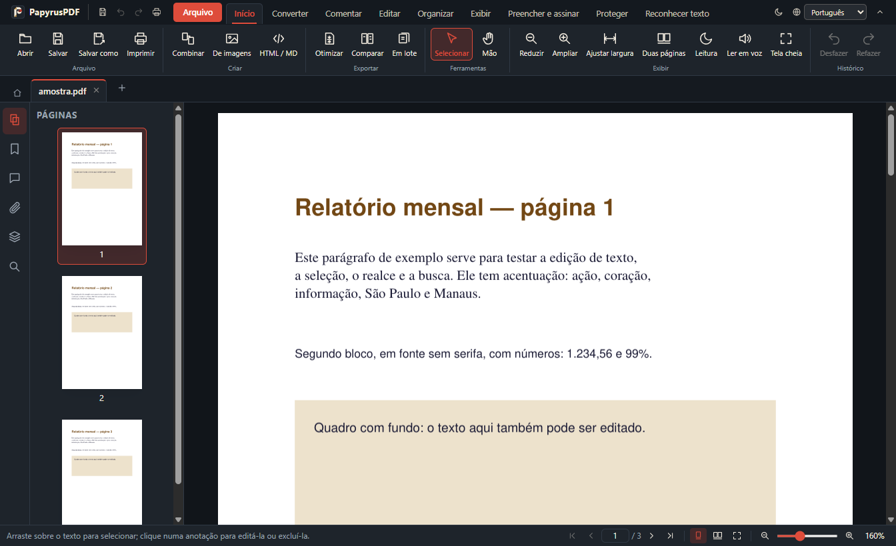
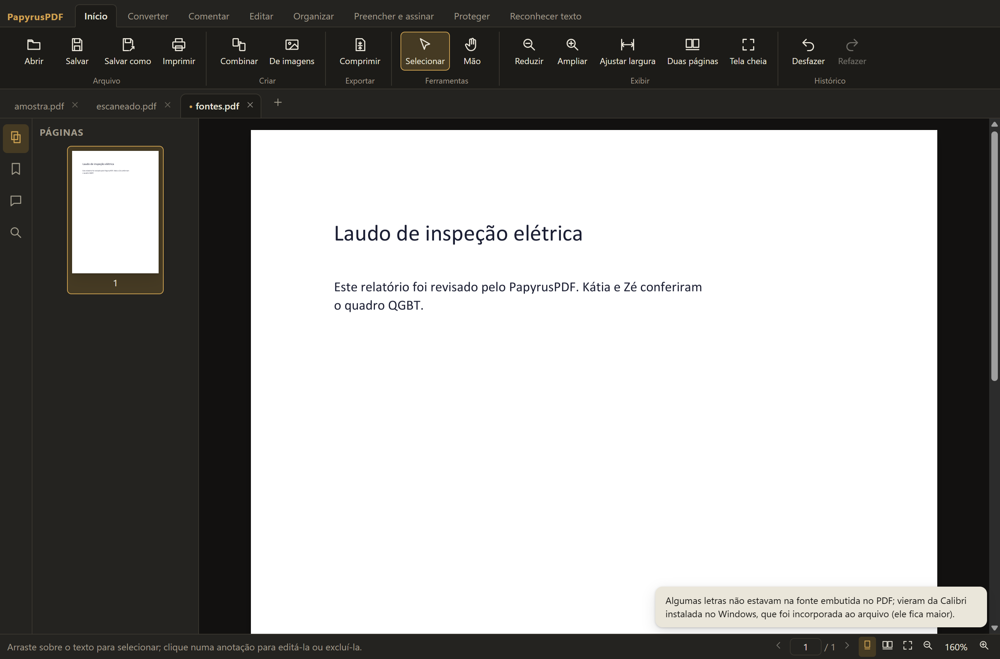

<p align="center">
  
</p>

<h1 align="center">PapyrusPDF</h1>

<p align="center">
  An open-source, <strong>100% offline</strong> PDF editor for Windows.<br>
  Read in tabs, edit text in its original font, run neural PP-OCRv5 OCR, build &amp; fill forms, sign with A1/PKCS#12 certificates,<br>
  redact sensitive data, compare revisions, optimize file size, and run multi-step batch workflows — with zero cloud calls.
</p>

<p align="center">
  
  
  
  
  
  
</p>

<p align="center">
  <a href="https://github.com/lucaszuzu17/PapyrusPDF/releases/latest"><b>⬇ Download Windows Installer</b></a> ·
  <a href="CHANGELOG.md"><b>Changelog</b></a>
</p>

<p align="center">
  
</p>

## Features

| Tab | Capabilities |
|---|---|
| **File (Backstage)** | Recent Documents, Create PDF, Document Properties, Save / Save As, **Advanced Print Dialog with Live Preview** (Scale, Poster Tiling, N-Up, Booklet, Duplex, Grayscale, Print as Image), Export, PDF Optimizer, Action Wizard & **Appearance Switcher** (Light Parchment / Dark Charcoal / System) |
| **Home** | Open, Save, Save As, **Print**, Combine PDFs, Create from Images, **Convert local HTML / Markdown to PDF**, **Space Audit & Optimizer**, **Compare PDFs** (text + visual diff), **Multi-Step Batch Wizard**, Zoom, Two-Page Spread, Reading Mode (Normal / Sepia / Night), **Offline Read Aloud (TTS)**, Full Screen, **Undo/Redo across saves** |
| **Convert** | PDF to Word (`.docx`), **Tables to CSV** (Excel), Plain Text (`.txt`), Images (PNG/JPEG); Images, HTML/Markdown, and Combine to PDF |
| **Comment** | Highlight, Underline, Strikeout, Sticky Notes, Text Boxes, Pencil, Rectangle, Ellipse, Line, Arrow, Stamps (with date & name), **Measurement Ruler** with scale (`1:1` to `1:500`), **Comments Summary Export** (PDF / Markdown / CSV) & sidebar filtering |
| **Edit** | **Edit existing PDF text** preserving embedded fonts (floating formatting bar + resizable text box + Type 3 font recovery + **scanned/OCR PDF background cover**), Add Unicode Text, Add Image, **Add / Edit Clickable Links**, **Find & Replace**, Header & Footer, Page Numbers, **Bates Numbering**, Watermark & **Remove Watermark** (Word, Acrobat, Foxit, PapyrusPDF) |
| **Organize** | Drag-and-drop Thumbnail Grid, Rotate, Delete, Insert Blank Page, Crop Margins (mm), Standardize to A4 / Letter, **Page Labels (`/PageLabels`)**, Insert PDF or Images, Extract Pages, Split Document |
| **View** | Single Page, Two-Page Spread, Full Screen, Zoom Controls & Status Slider, Reading Mode (Normal / Sepia / Night), Offline Read Aloud (TTS), Compare PDFs |
| **Fill & Sign** | Fill interactive forms, Visual Signature (draw or import), Type on PDF, **Interactive Form Builder** (text, multiline, checkbox, dropdown, signature), **Auto-Detect Form Fields**, **Offline Digital Signatures (`.pfx` / `.p12` / ICP-Brasil A1)** & **Signature Verification** |
| **Protect** | AES-256 Password & Permissions with strength meter and generator, Recipient-Watermarked Copies, Image-Only Rasterized Copies, Remove Security, **Flatten PDF**, **Sanitize Hidden Metadata (Info/XMP)**, Manual Redaction & **Smart Pattern Redaction** (CPF, CNPJ, credit card, email, phone, ZIP/CEP, RG, custom regex + overlay labels) |
| **Recognize Text** | **Offline Neural OCR (PaddleOCR PP-OCRv4/v5 ONNX)** + Tesseract Best/Fast fallback, **Auto-Orientation (0°/90°/180°/270°)**, **Local Shadow Removal**, Adaptive Contrast, and `±6°` Deskew across Portuguese, English, Spanish & 29 other Latin languages |

### Everyday Details

- **Multi-Language UI (`EN`, `PT`, `ES`):** Automatically follows your Windows system language on launch, with a live switcher in the top-right tab bar.
- **Tabbed Workflow & Sidebar Panels:** Each PDF opens in its own tab remembering page, zoom, and search. Includes sidebar panels for **Pages**, **Bookmarks** (interactive editor + **Auto-generate from headings**), **Comments** (searchable/filterable), **Attachments** (embed/extract/remove files), **Layers (OCG)** (live visibility toggles), and **Search & Replace**.
- **Drag & Drop + Single Instance:** Drop a PDF to open, multiple PDFs to combine, or images to create/insert pages. Opening another PDF from File Explorer adds a tab to the running window.
- **Crash Auto-Recovery:** Periodically saves offline local drafts for unsaved documents so work can be restored after an unexpected crash.
- **100% Offline & Private:** No accounts, no telemetry, no cloud APIs. OCR models (19.4 MB ONNX + Tesseract packs) ship locally inside the app, HTML-to-PDF blocks all `http`/`https`/`ws` requests, and Electron's online spellchecker dictionary download is disabled.

**Shortcuts:** `Ctrl+O`, `Ctrl+S`, `Ctrl+Shift+S`, `Ctrl+P`, `Ctrl+W`, `Ctrl+Tab` / `Ctrl+Shift+Tab`, `Ctrl+Z`, `Ctrl+Y`, `Ctrl+F`, `Ctrl+H`, `F3`, `F11` (Full Screen; arrow keys turn pages), `Ctrl` + scroll wheel, `Esc`, `Delete`.

## Screenshots

| Tabs & Two-Page Spread | Editing Text in the Embedded Font |
|---|---|
|  |  |

| Direct PDF Text Editing | Stamps, Watermarks & Footers |
|---|---|
|  |  |

| Page Organizer | Offline OCR (Searchable Scans) |
|---|---|
|  |  |

| OCR Language & Options | Strong Password & Recipient Copy |
|---|---|
|  |  |

| Form Filling | Annotations & Drawing |
|---|---|
|  |  |

## Install

Download `PapyrusPDF-Setup-<version>.exe` from the [Releases](https://github.com/lucaszuzu17/PapyrusPDF/releases/latest) page and run it.

- **Per-user installation** (no admin privileges required), multi-language installer (`English`, `Português`, `Español`), desktop & Start Menu shortcuts, and clean uninstaller.
- Registers PapyrusPDF in **"Open with"** for `.pdf` files without hijacking your default viewer.
- **Unsigned open-source binary:** On first launch Windows SmartScreen may show *"Windows protected your PC"* — click *More info* → *Run anyway*.
- To build the installer from source, follow [Development](#development) and run `npm run dist` (outputs `dist\PapyrusPDF-Setup-<version>.exe`).

<p>
  
  &nbsp;&nbsp;
  
</p>

## Development

Requirements: Windows 10 or 11 (64-bit) and Node.js 24.2+.

```bash
npm install
npm start
```

`npm start` compiles and launches the app. To open a file directly: `npx electron-vite preview -- path\to\file.pdf`.

| Command | Description |
|---|---|
| `npm run dev` | Start with hot reload |
| `npm test` | Run all **74 unit tests** (core engine, fonts, Type 3 recovery, annotations, Neural PP-OCRv5 + Option B cleanup, Tesseract OCR, A1 signatures, form builder, Tier 1 & Tier 2 features, i18n) |
| `npm run typecheck` | Run TypeScript type checking (`tsc --noEmit`) |
| `npm run build` | Build Electron `main`, `preload`, and `renderer` bundles |
| `npm run dist` | Build Windows x64 NSIS installer (`dist\PapyrusPDF-Setup-<version>.exe`) |
| `npm run e2e` | Run end-to-end UI scenarios with real mouse/keyboard input |
| `npm run e2e:dist` | Run end-to-end scenarios against the packaged build (`dist\win-unpacked`) |
| `npm run icon` | Regenerate vector icons (`build/icon.ico` and `build/file.ico`) |

## Architecture

```text
models/ocr/             bundled offline Apache-2.0 PaddleOCR ONNX models (19.4 MB)
  det.onnx                PP-OCRv4 mobile DBNet++ text detector
  rec_latin.onnx          PP-OCRv5 Latin SVTR text recognizer (32 languages)
  dict_latin.txt          Latin character dictionary
  doc_ori.onnx            PP-LCNet 0°/90°/180°/270° document orientation classifier
src/shared/
  i18n.ts                 typed offline translations (en, pt, es) + system locale resolver
src/engine/             UI-free PDF engine (MuPDF + ONNX Runtime + Tesseract + node-forge)
  core.ts                 PdfEngine: open, render, text, search, annotations, forms, OCR, convert, undo-across-saves
  ocr-paddle.ts           PaddleOCR PP-OCRv4/v5 ONNX inference + word-level CTC alignment
  ocr-prep.ts             local uneven-shadow removal, adaptive contrast, 90°/180°/270° rotation, ±6° deskew
  ocr-node.ts             unified OCR router (Neural PP-OCRv5 default + Tesseract Best/Fast fallback)
  sign.ts                 offline PKCS#7/CMS digital signatures (.pfx/.p12) and tamper verification
  forms.ts                interactive AcroForm widget builder + automatic field detector
  tier1.ts                smart PII/LGPD redaction, comments summary export, auto-bookmarks
  fonts.ts / fontname.ts  embedded PDF font reuse, ToUnicode parsing, Windows font fallback
  type3.ts                Type 3 vector font /FontBBox repair and glyph-OCR recovery
  docx.ts / tables.ts     Word (.docx) and CSV table exporters
  compare.ts              side-by-side text + pixel-diff document comparison
  watermarks.ts           watermark detection & removal (Acrobat, Foxit, Word, PapyrusPDF)
src/main/               Electron main process
  index.ts                window, localized native dialogs, IPC, vector SVG print, HTML/MD→PDF, recovery, recents
  engine-worker.ts        dedicated worker thread (one PdfEngine per tab)
  markdown.ts             offline Markdown-to-HTML renderer
  system-fonts.ts         Windows system font registry lookup
src/preload/            contextIsolation bridge (window.papiro)
src/renderer/src/       React 19 UI (Ribbon, Viewer, PageView, Sidebar, Organizer, Dialogs, TTS, features, state)
test/                   74 automated Node tests + E2E runner
```

### How Key Subsystems Work

- **Neural OCR (PP-OCRv5 + Option B):** Each page is rendered at high DPI, automatically checked for 0°/90°/180°/270° orientation (`doc_ori.onnx`), cleaned via local background-division shadow removal and `±6°` deskew (`ocr-prep.ts`), detected with DBNet++ (`det.onnx`), and recognized with PP-OCRv5 Latin (`rec_latin.onnx`) with per-word CTC bounding boxes. Any orientation fix and invisible text layer are committed together in one undoable `Ctrl+Z` operation.
- **Text Editing:** Removes only the text in the target area (preserving images and vector art) and writes back in the same baseline, size, and color, trying (1) the PDF's own embedded font, (2) the matching Windows system font, and (3) a standard PDF fallback font.
- **Digital Signatures:** Signs PDF bytes offline with standard `adbe.pkcs7.detached` (SHA-256) using user-supplied `.pfx` / `.p12` certificates (compatible with ICP-Brasil A1). Passwords are never stored.
- **No ASAR packaging by design:** MuPDF WASM, `onnxruntime-node`, PaddleOCR ONNX models, and Tesseract data load directly from disk inside worker threads.

## Known Limitations

- **Text editing style scope:** An edited paragraph uses the predominant font of the block (mixed inline bold/italic within a single edited paragraph is unified).
- **Word export:** Exports paragraphs, formatting, and images for editing rather than a pixel-identical fixed-layout clone; run OCR first on scanned PDFs.
- **Digital signature revocation:** Offline verification validates cryptographic integrity (`ByteRange` SHA-256 digest and PKCS#7 signature) and certificate validity window, without online OCSP/CRL revocation lookups (by design, to stay 100% offline).
- **Windows only:** Built and packaged for Windows 10/11 (x64).

> Internally, some storage keys (`window.papiro`, `papiro.signature`, package name `papiro-pdf`) keep the original v0.2 name so existing user preferences migrate seamlessly.

## License & Credits

PapyrusPDF is free software licensed under the **GNU Affero General Public License v3.0 or later** ([LICENSE](LICENSE)).

Built with these open-source projects:

| Project | Role | License |
|---|---|---|
| [MuPDF](https://mupdf.com/) (`mupdf` JS by Artifex) | PDF parsing, rendering, editing & writing | AGPL-3.0-or-later |
| [PaddleOCR](https://github.com/PaddlePaddle/PaddleOCR) (PP-OCRv4/v5 & PP-LCNet ONNX models) | Neural OCR detection, recognition & orientation | Apache-2.0 |
| [ONNX Runtime](https://onnxruntime.ai/) (`onnxruntime-node`) | Offline CPU neural inference | MIT |
| [tesseract.js](https://github.com/naptha/tesseract.js) & `@tesseract.js-data/*` | Secondary/fallback OCR engine | Apache-2.0 / MIT |
| [node-forge](https://github.com/digitalbazaar/forge) | Offline PKCS#12 / PKCS#7 digital signatures | BSD-3-Clause / GPL-2.0 |
| [Electron](https://www.electronjs.org/) & [React](https://react.dev/) | Desktop runtime & UI | MIT |
| [electron-vite](https://electron-vite.org/) & [electron-builder](https://www.electron.build/) | Bundling & Windows NSIS installer | MIT |
